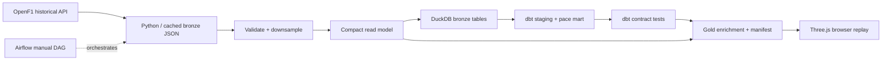

# APEX / Race Lab

**An interactive 3D Formula 1 replay and a reproducible data engineering lab.**

[Open the Site](https://apex-race-lab-massibrevo.chicfox256.chatgpt.site) · [OpenF1](https://openf1.org/docs/) · [Engineering guide](docs/engineering.md)

Explore measured GPS positions, inspect car telemetry, compare recorded race lap times, and follow a dataset from API ingestion to a tested analytical warehouse. Original browser implementation inspired by [IAmTomShaw/f1-race-replay](https://github.com/IAmTomShaw/f1-race-replay). No upstream source code or assets are copied.

## Run the website

Requires Python 3.9+ to serve files. No API key, npm installation or build step is needed to view the bundled archive.

```bash
git clone https://github.com/massibrevo/apex-race-lab.git
cd apex-race-lab
make dev
# http://127.0.0.1:4173
```

Three.js is vendored with its MIT license. Node 22+ runs the replay tests. `npm ci` is only needed to refresh development dependencies.

## Explore

- **Race replay:** 3D cars on a measured circuit outline; orbit, top-down and driver-follow cameras. Play/pause, seek, 1×–10× speed, tyre stints and recorded race positions. The camera fits the measured circuit automatically.
- **Driver focus:** measured speed, throttle, brake, gear and a second driver's speed trace. Select a driver in the timing tower.
- **Telemetry:** recorded session lap-time comparison, pit-out filtering and CSV export.
- **Data lab:** sample counts, lineage, quality checks, source provenance and downloadable read models.
- Keyboard: **Space** plays/pauses; **← / →** seek 15 seconds. Drag the circuit to orbit; scroll to zoom. WebGL failure falls back to a 2D map.

### What is recorded

The archive includes **all 48 Grands Prix: 24 in 2024 and 24 in 2025**. Use the season and race selectors to browse each calendar. Every race has recorded session lap timing; the 2024 races also have eight-minute measured GPS/telemetry excerpts. [Complete race list](docs/archive.md).

Available GPS replays contain **eight-minute excerpts, not complete race GPS replays**. Each archive uses the actual race participants; retired cars and gaps can have no current measurement. Approximately 1 Hz samples are exported from the higher-frequency OpenF1 feed. GPS is linearly interpolated only across gaps ≤5 seconds. Telemetry uses the latest valid sample ≤5 seconds old. Race positions use the latest recorded position event. There is no simulated telemetry, lap-based car positioning, live feed, or invented timing gap.

The circuit outline comes from a driver's measured lap. Elevation, grandstand-like structures and lighting are illustrative. Track weather shows the latest observation at the **start** of the excerpt. Pit-out filtering alone does not normalize fuel, traffic, weather or race strategy; mean lap comparisons are descriptive.

## Data engineering lab

Use **Python 3.12**, Node 22 and Make. The analytical stack runs locally or in your own infrastructure; Sites hosts the static read model and browser application.

```bash
make setup
make pipeline SESSION=9590  # OpenF1 -> cached bronze JSON -> validated compact read model
make backfill               # discover and build any missing 2024/2025 race archives
make warehouse              # read models -> DuckDB bronze tables
make transform              # dbt views, driver pace mart, contract tests -> gold enrichment
make test                   # replay behavior and all 48 archive contracts
```

**Current replay coverage:** all 24 races from 2024 have measured GPS/car telemetry. All 24 races from 2025 have recorded session lap timing, driver comparisons and CSV exports; their GPS replay downloads are pending upstream access. The UI labels timing-only races and opens their analysis view, rather than showing a fabricated replay. `make backfill` retries timing-only races and upgrades them when the public API becomes accessible again.

OpenF1 temporarily restricts even historical downloads during live sessions. Optional authenticated ingestion reads `OPENF1_ACCESS_TOKEN` from the process environment; credentials are never written to source files. FastF1's upstream archive also currently requires authentication, so this release does not rely on that fallback.

No paid services or cloud accounts are required. OpenF1 historical access is public. Ingestion uses bounded exponential backoff, atomic cache writes and request pacing. The API has rate limits; do not run independent ingestion jobs against the same budget concurrently.



See [docs/engineering.md](docs/engineering.md) for schemas, orchestration, exercises and extending the archive. The GitHub Actions workflow checks the bundled data, replay behavior and DuckDB/dbt transformations without requesting external F1 data.

## Source layout

```text
dist/                    deployable application + small bundled read models
pipeline/ingest.py       public API extraction, local cache and backoff
pipeline/export.py       sample normalization, validation, browser export
pipeline/catalog.py      discover both complete race calendars
pipeline/build_archive.py resumable season backfill
pipeline/warehouse.py    DuckDB load
pipeline/publish.py      tested mart enrichment and gold manifest
dbt/                     staging models, pace mart and SQL tests
dags/apex_archive.py     Airflow 3 manual workflow
tests/                   replay and archive contracts
.github/workflows/ci.yml automated validation
```

## Hosting

The supplied `.openai/hosting.json` identifies this Site. Forks should remove `project_id` and register their own Site, or serve `dist/` on any static host. The deployed Site and GitHub repository are public. No credentials belong in source control.

## Attribution and rights

Application code is MIT licensed. Three.js retains its included MIT license. OpenF1 is an independent data provider and describes its platform/data use for educational, research and non-commercial fan engagement; see [OpenF1 terms and attribution](https://openf1.org/) and [CC BY-NC-SA 4.0](https://creativecommons.org/licenses/by-nc-sa/4.0/). Bundled F1 data is attributed to OpenF1 and is not relicensed as MIT. This is an independent educational project, unaffiliated with Formula 1, FIA or any team. Team and driver names identify recorded participants; no official logos are included.
